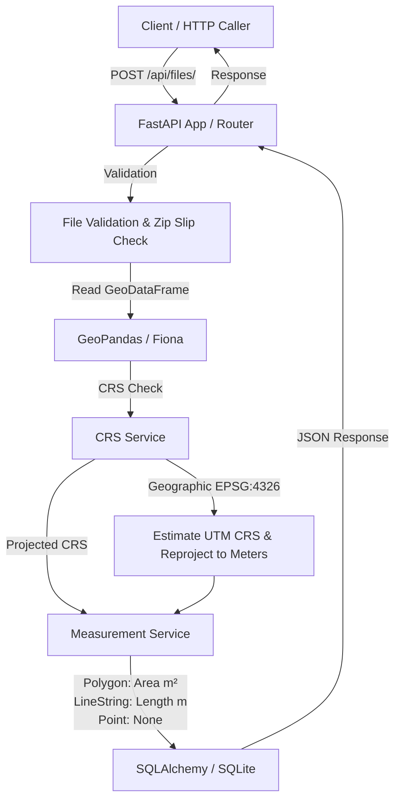

# Geospatial File Measurement API

A production-quality, clean, and maintainable FastAPI backend service that accepts geospatial files (`.kml` or `.zip` containing Shapefiles), extracts features, dynamically reprojects geometries to appropriate projected coordinate reference systems (CRS), calculates spatial measurements (area for Polygons, length for LineStrings), and exposes REST endpoints.

Built for **Aereo** technical assessment.

---

## Architecture Diagram



---

## Features

- **Multi-Format Geospatial Support**: Accepts `.kml` files and `.zip` archives containing ESRI Shapefiles (`.shp`, `.shx`, `.dbf`, `.prj`).
- **Robust Security**:
  - **Zip Slip & Path Traversal Protection**: Validates target extraction paths for ZIP members before extracting.
  - **File Size Validation**: Enforces configurable file size limits (default: 50 MB).
  - **Safe Temporary Storage**: Extracts files inside isolated temporary directories with automatic cleanup.
- **Automated Projected CRS Selection**:
  - Automatically detects geographic coordinate systems (e.g., `EPSG:4326` using lat/lon degrees).
  - Dynamically calculates the optimal projected UTM zone based on dataset bounding box (`estimate_utm_crs()`) and reprojects geometries to metric units.
  - Handles missing CRS gracefully without silently assuming default projections.
- **Accurate Spatial Measurements**:
  - `Polygon` / `MultiPolygon`: Calculates total area in **square meters** (`square_meters`).
  - `LineString` / `MultiLineString`: Calculates total length in **meters** (`meters`).
  - `Point` / `MultiPoint`: Handles gracefully without measurement (`measurement_type: "none"`).
  - **Unsupported Geometries**: Continues processing valid features without application crashes.
- **Clean RESTful API**: Provides endpoints for upload, file metadata retrieval, and feature-level measurements.

---

## Technology Stack

- **Python**: 3.12+
- **Framework**: FastAPI
- **Data Validation & Schemas**: Pydantic v2 & Pydantic-Settings
- **ORM & Database**: SQLAlchemy (SQLite for local dev)
- **Geospatial Processing**: GeoPandas, Shapely, PyProj, Fiona / Pyogrio
- **Server**: Uvicorn
- **Testing**: pytest, httpx, Starlette TestClient
- **Containerization**: Docker & Docker Compose

---

## Project Structure

```
geospatial-measurement-api/
├── app/
│   ├── main.py                  # Application entry point & lifespan setup
│   ├── api/
│   │   └── files.py             # API route handlers (POST /files, GET /files/{id})
│   ├── core/
│   │   └── config.py            # Environment & app configuration
│   ├── db/
│   │   ├── database.py          # Database connection & session management
│   │   └── models.py            # SQLAlchemy models (FileModel, MeasurementModel)
│   ├── schemas/
│   │   └── file.py              # Pydantic request/response schemas
│   ├── services/
│   │   ├── crs.py               # CRS detection & projected UTM transformation
│   │   ├── file_processor.py    # Main file parsing & orchestration pipeline
│   │   └── measurement.py       # Spatial area & length calculation service
│   └── utils/
│       └── file_utils.py        # File validation, size check, safe ZIP extraction
├── tests/
│   ├── conftest.py              # Pytest fixtures with isolated SQLite memory database
│   ├── test_upload.py           # Endpoint upload tests & status checks
│   ├── test_measurements.py     # Measurement accuracy & geometry tests
│   ├── test_crs.py              # CRS reprojection & missing CRS handling tests
│   └── test_security.py         # Zip Slip security & path traversal tests
├── sample_data/                 # Pre-generated sample KML & Shapefile archives
├── uploads/                     # Storage directory for uploaded raw files
├── Dockerfile                   # Docker build container recipe
├── docker-compose.yml           # Docker Compose configuration
├── requirements.txt             # Locked dependencies
├── .env.example                 # Example environment variables
├── .gitignore                   # Git ignore file
├── README.md                    # Project documentation
└── INTERVIEW_NOTES.md           # Technical interview guide & deep-dive explanation
```

---

## Setup & Running Locally

### 1. Prerequisites
- Python 3.12+
- GDAL system libraries (installed automatically on macOS via Homebrew `brew install gdal` or Linux `apt-get install gdal-bin libgdal-dev`).

### 2. Environment Setup

```bash
# Clone repository
git clone https://github.com/your-username/geospatial-measurement-api.git
cd geospatial-measurement-api

# Create virtual environment
python3 -m venv venv
source venv/bin/activate

# Upgrade pip and install dependencies
pip install --upgrade pip
pip install -r requirements.txt
```

### 3. Run Application

```bash
uvicorn app.main:app --host 127.0.0.1 --port 8000 --reload
```

The interactive OpenAPI documentation will be available at:
- **Swagger UI**: [http://localhost:8000/docs](http://localhost:8000/docs)
- **ReDoc**: [http://localhost:8000/redoc](http://localhost:8000/redoc)

---

## Running with Docker & Docker Compose

Run the entire application in a containerized environment with a single command:

```bash
docker compose up --build
```

Access the API at `http://localhost:8000` and Swagger docs at `http://localhost:8000/docs`.

---

## API Documentation

### 1. `POST /api/files/`
Upload and process a geospatial file (`.kml` or `.zip` containing a Shapefile).

- **Method**: `POST`
- **Content-Type**: `multipart/form-data`
- **Request Form Field**: `file` (File binary)

#### Example Request
```bash
curl -X POST "http://localhost:8000/api/files/" \
  -F "file=@sample_data/valid.kml"
```

#### Example Response (`201 Created`)
```json
{
  "id": "45fe1301-5978-4bd7-bf2e-1b4ed5c1f815",
  "filename": "valid.kml",
  "file_type": "kml",
  "status": "COMPLETED",
  "feature_count": 3,
  "crs": "EPSG:4326",
  "created_at": "2026-10-06T19:08:05.538256Z",
  "error_message": null
}
```

---

### 2. `GET /api/files/{id}/`
Retrieve metadata and status for an uploaded file.

- **Method**: `GET`

#### Example Request
```bash
curl -X GET "http://localhost:8000/api/files/45fe1301-5978-4bd7-bf2e-1b4ed5c1f815/"
```

#### Example Response (`200 OK`)
```json
{
  "id": "45fe1301-5978-4bd7-bf2e-1b4ed5c1f815",
  "filename": "valid.kml",
  "file_type": "kml",
  "status": "COMPLETED",
  "feature_count": 3,
  "crs": "EPSG:4326",
  "created_at": "2026-10-06T19:08:05.538256Z",
  "error_message": null
}
```

---

### 3. `GET /api/files/{id}/measurements/`
Retrieve calculated spatial measurements for all features in the uploaded file.

- **Method**: `GET`

#### Example Request
```bash
curl -X GET "http://localhost:8000/api/files/45fe1301-5978-4bd7-bf2e-1b4ed5c1f815/measurements/"
```

#### Example Response (`200 OK`)
```json
{
  "file_id": "45fe1301-5978-4bd7-bf2e-1b4ed5c1f815",
  "measurements": [
    {
      "feature_id": 0,
      "geometry_type": "Polygon",
      "measurement_type": "area",
      "value": 12016.98,
      "unit": "square_meters"
    },
    {
      "feature_id": 1,
      "geometry_type": "LineString",
      "measurement_type": "length",
      "value": 155.04,
      "unit": "meters"
    },
    {
      "feature_id": 2,
      "geometry_type": "Point",
      "measurement_type": "none",
      "value": null,
      "unit": null
    }
  ]
}
```

---

## CRS Handling Strategy

### Why Geographic Systems (e.g., EPSG:4326) Cannot Be Used Directly
Geographic Coordinate Reference Systems such as `EPSG:4326` express coordinates in **angular units (degrees)** of latitude and longitude on a 3D spherical/ellipsoidal model of Earth.
- Performing Euclidean geometry calculations (`geom.area` or `geom.length`) directly on geographic coordinates calculates values in **square degrees** or **degrees**, which vary significantly depending on latitude (1 degree of longitude at the Equator is ~111 km, but contracts to 0 km at the Poles).
- Therefore, spatial measurement on geographic coordinates produces distorted, meaningless results.

### Automated Projected CRS Strategy
1. **Detection**:
   - Inspect `gdf.crs`. If `gdf.crs is None`, reject processing with status `FAILED` and error message `Geospatial file does not specify a Coordinate Reference System (CRS).`. Do **NOT** silently assume `EPSG:4326`.
2. **Reprojection**:
   - If `gdf.crs.is_geographic` is True, use `gdf.estimate_utm_crs()` to calculate the optimal Universal Transverse Mercator (UTM) zone for the centroid/bounding box of the dataset.
   - Transform GeoDataFrame coordinates using `gdf.to_crs(utm_crs)`.
3. **Measurement**:
   - All spatial measurements are computed on the reprojected GeoDataFrame in planar linear units (**meters** and **square meters**).

---

## File Processing & Measurement Calculation Flow

1. **Upload & Validation**:
   - File extension checked against `.kml` and `.zip`.
   - File size validated against max limit (50 MB).
   - Saved to disk under `uploads/{file_id}/{filename}`.
2. **Extraction & Parsing**:
   - If `.zip`, members are inspected for Zip Slip path traversal before extracting to a temporary directory. The inner `.shp` file is located and read with GeoPandas.
   - If `.kml`, parsed using Fiona KML driver.
3. **Measurement Calculation**:
   - Iterates through each feature geometry in the projected GeoDataFrame.
   - Computes area for `Polygon`/`MultiPolygon` and length for `LineString`/`MultiLineString`.
   - Leaves `value` as `null` for `Point`/`MultiPoint`.
   - Catches unsupported geometry types without halting processing for remaining features.
4. **Persistence**:
   - Stores job metadata in `FileModel` and feature measurements in `MeasurementModel`.

---

## Security Considerations

- **Zip Slip / Path Traversal Protection**: Every ZIP entry target path is resolved and verified to reside inside the temporary target directory (`member_path.startswith(target_dir)`).
- **File Size Caps**: Upload stream enforces strict chunk-level size checks to avoid disk saturation or memory denial of service.
- **Safe Execution Environment**: Uploaded files are treated purely as binary spatial data files and never executed.
- **Isolated Storage**: Uploaded files are isolated by UUID folder names to avoid path collisions.

---

## Testing

Run the automated pytest suite:

```bash
pytest -v
```

### Covered Scenarios:
- Uploading valid KML file
- Uploading valid Shapefile ZIP archive
- Rejection of invalid file extensions
- Rejection of malformed ZIP archives (missing `.shp`)
- Proper failure handling for files missing CRS
- Accurate projected UTM transformation from EPSG:4326
- Polygon area & LineString length measurement validation
- Graceful handling of Points and unsupported geometries
- Zip Slip path traversal security enforcement

---

## Architectural Decisions & Design Rationale

- **FastAPI**: Provides asynchronous web framework capabilities, automatic OpenAPI documentation, high performance, and Pydantic validation.
- **GeoPandas & Shapely & PyProj**: Industry-standard geospatial Python stack providing robust OGR file driver abstraction, vector geometry operations, and PROJ projection support.
- **Synchronous Processing Architecture**: Chosen for clean simplicity and maintainability in an internship technical assessment. Processing executes reliably within request handler context while providing accurate status state machine updates (`UPLOADED` → `PROCESSING` → `COMPLETED`/`FAILED`).
- **Relational Metadata DB**: SQLite via SQLAlchemy stores lightweight file metadata and calculated feature measurements without requiring a heavy spatial database extension like PostGIS.

---

## Future Scope

- **Asynchronous Task Queue**: Integrate Celery/Redis or Arq for background worker processing of large spatial datasets (> 500 MB).
- **Object Storage**: Offload raw file storage from local disk to S3/GCS.
- **PostGIS Integration**: Store raw feature geometries in PostgreSQL/PostGIS for spatial queries, indexing, and map visualization.
- **Streaming & Chunking**: Support streaming parsers for multi-gigabyte GeoJSON or KML files.
